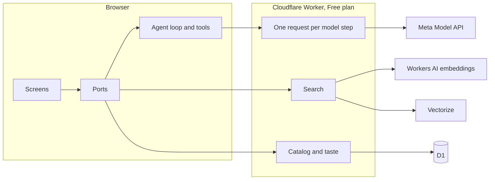

# MoreAI MetaAgent

An Agentic Commerce assistant, built on Meta's models for local Egyptian brands. Tell it what you want in your own words. It finds pieces across every brand, looks at their photos, remembers your taste, and stays with you through to a placed order, asking before anything changes.

**Try it, with no login:** https://moreai-metaagent.khaled-m2225.workers.dev

The brands and products are made up for this demo, and the product photos are generated with Muse Image.

Built by Khaled Mohammed for the Meta Global AI Developer Hackathon 2026, on the Indie Developer track, from 26 October to 4 November 2026. Everything in this repo was built during that time, for this hackathon.

## What it does

**For shoppers**

- Chat with an agent that searches by meaning, looks at candidate photos, and suggests up to 3 pieces with a reason
- Attach a photo of your outfit and ask for a jacket in the same color, or what would match it, and the agent looks at your clothes and chooses
- A stated budget is a hard limit: a 1,000 EGP jacket never appears for "a black jacket under 500"
- Search with a photo: Muse Spark names each piece, SAM 3.1 finds where it is, and search finds similar ones
- One cart across brands, which the agent can add to, change and remove from, each change after the shopper confirms. It becomes one order per brand, with live order status
- A taste profile the shopper can see and edit, shown as animated bullets in their account

**For merchants**

- Join with a name, a bio and an image, then add a product from one photo
- Muse Spark reads the photo into a name, a description, a category and a color. The merchant reviews everything, and nothing goes live until they approve it
- Receive orders, move them along, and see each shopper's delivery record

## How Meta's models are used

| Model | Where | Why |
| --- | --- | --- |
| `muse-spark-1.3` | The agent loop, on the Responses API with `previous_response_id` | Decides which of 9 tools to call, one step at a time |
| `muse-spark-1.3` | Vision, with `input_image` | Reads candidate photos while choosing, each merchant's photo with structured output, and each piece in a shopper's photo |
| `sam-3.1` | Search with a photo | Finds each piece, one concept per request, and the page draws its box |
| `muse-image-1.0` | `scripts/generate-product-photos.mjs` | Generated all 200 catalog photos |

The live trace beside the chat shows every model call and tool call as it happens, with its real duration.

## Architecture



**Search that understands photos.** Muse Spark reads each product photo into a description. Workers AI turns that into a vector in Vectorize. A request filters on price, category and color first, in the index and again in code, then ranks by closeness. If the index is unavailable, it falls back to filters, behind the same `ProductSearch` interface.

**The model only proposes.** Budgets, stock and totals are checked in code. Tool arguments are validated. Every change to the cart, and placing an order, waits for the shopper's confirmation. The delivery address never reaches the model.

**Spending is guarded on the server.** The key, instructions and tools live only in the Worker, and a page can't change them. It only accepts the shopper's own words, this site's product photos, one attached photo and tool results. Every answer has a token ceiling, and the real cost of each call adds up against a hard daily cap in D1, along with limits per visitor.

**Clean architecture.** Features never import each other, and view models never navigate: a coordinator does. Every outside dependency is a port, and only `apps/web/src/app/container.ts` picks an implementation, so the demo data and the real backend swap in one place. `apps/web/src/architecture.test.ts` enforces these rules on every test run.

Each visitor's cart and orders stay in their own browser, so people testing the public link never see each other's. A merchant's new products stay in that browser too, so nothing a visitor adds is shown to anyone else. Photos go to Meta's API to be read, and this app doesn't store them.

## Run it yourself

You need Node 22.13 or later and a key from [dev.meta.ai](https://dev.meta.ai).

```bash
npm install
```

```bash
cp apps/api/.dev.vars.example apps/api/.dev.vars
```

Add your key to `apps/api/.dev.vars`, then:

```bash
npm run local:setup
```

```bash
npm run local:start
```

It opens on http://localhost:8787. Locally, Vectorize isn't available, so search uses the filter fallback, and the agent can't see photos, since Meta's API needs a public address for them. To run all of it, deploy to your own Cloudflare account, using `apps/api/wrangler.jsonc` and the scripts in `scripts/`.

To see every screen with no key at all, on static data:

```bash
npm run dev --workspace @metaagent/web
```

Then open `/review` to see every state of every screen.

## Tests

```bash
npm test
```

```bash
npm run typecheck
```

## Repo

- `apps/web`: the React app. `src/features` holds the screens, `src/core/data/remote` the real backend and agent loop, and `src/core/data/static` the demo data
- `apps/api`: the Cloudflare Worker
- `packages/design-system`, `packages/i18n`: the UI parts, and language support. The live version is in English, and Arabic is built in and switched off for now
- `scripts`: generating the photos, reading them with Muse, and seeding the database and index
